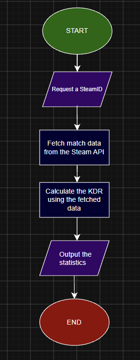

# cs2-stat-tracker
Statistics tracker for CS2 using the Steam Web API

A statistic tracker for FPS games, Counter Strike 2 in Particular. I want to build something that can help me understand my statistics by looking at all games played on my account, and calculating averages like my K/D, Average damage per round,  Average Assists and MVPs.

MVP
- Take a Steam ID
- Fetch CS2 stats from the Steam Web API
- Calculate K/D, average damage per round, MVPs
- Print the result
  
Diagram

Plans
- Set up the repo and environment
- Test the API key manually
- Fetch CS2 Data
- Calculate the Averages
- Make an interface
- Add JSON caching
- Document all the steps above while doing them

